# Chapter 1: Scale from Zero to Millions of Users

## Introduction
Scaling a system to millions of users is iterative. You refine and optimize as you go. This chapter starts with a single server and scales the architecture step by step.

---

## Section 1: Single Server Setup
Everything (web app, database, cache) runs on one server at first. 

   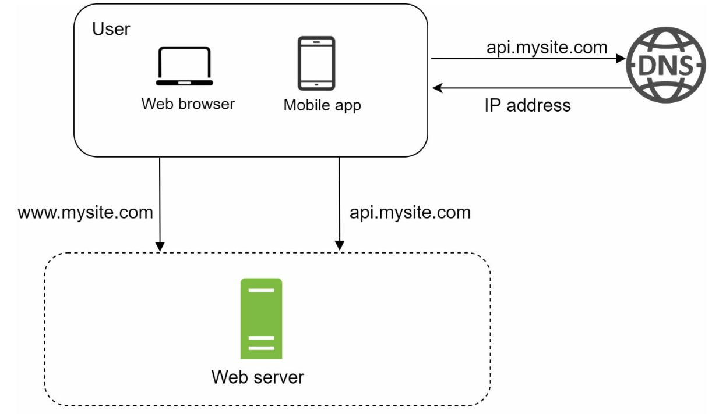

### Request Flow
1. Users reach the app through a domain name (e.g., `api.mysite.com`), which DNS resolves to an IP address.
2. The IP address of the web server goes back to the browser or mobile app.
3. The client sends HTTP requests to the web server, which returns HTML or JSON.

### Traffic Sources
1. **Web Applications:** Server-side languages (e.g., Python, Java) handle business logic. Client-side languages (e.g., JavaScript, HTML) handle presentation.
2. **Mobile Applications:** Talk to the web server over HTTP, using JSON as the lightweight data format.

---

## Section 2: Database Separation
As the user base grows, the database moves to its own server so the web tier and the database tier can scale independently.

   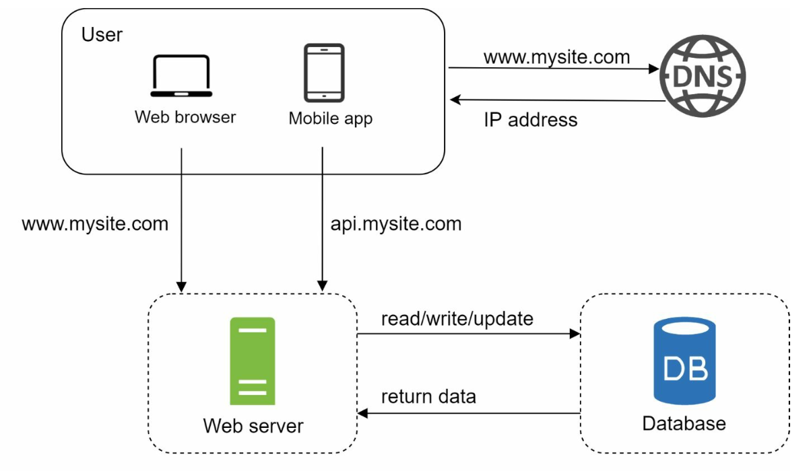

### Database Choices

1. **Relational Databases (SQL):** Structured data stored in tables. Examples: MySQL, PostgreSQL.
2. **Non-Relational Databases (NoSQL):** Fit unstructured data or low-latency needs. Categories:
   - Key-Value Stores
   - Graph Databases
   - Column Stores
   - Document Stores

- Non-relational databases might be the right choice if:
   - the application needs very low latency.
   - the data is unstructured, or there is no relational data.
   - you only need to serialize and deserialize data (JSON, XML, YAML, etc.).
   - you need to store a massive amount of data.

---

## Section 3: Vertical vs Horizontal Scaling
### Vertical Scaling
- Add more resources (CPU, RAM) to existing servers.
- Capped by hardware limits, and there is no redundancy.

### Horizontal Scaling
- Add more servers to the pool. Better suited to large systems.
- A load balancer routes requests between the servers.
---

## Section 4: Load Balancer

   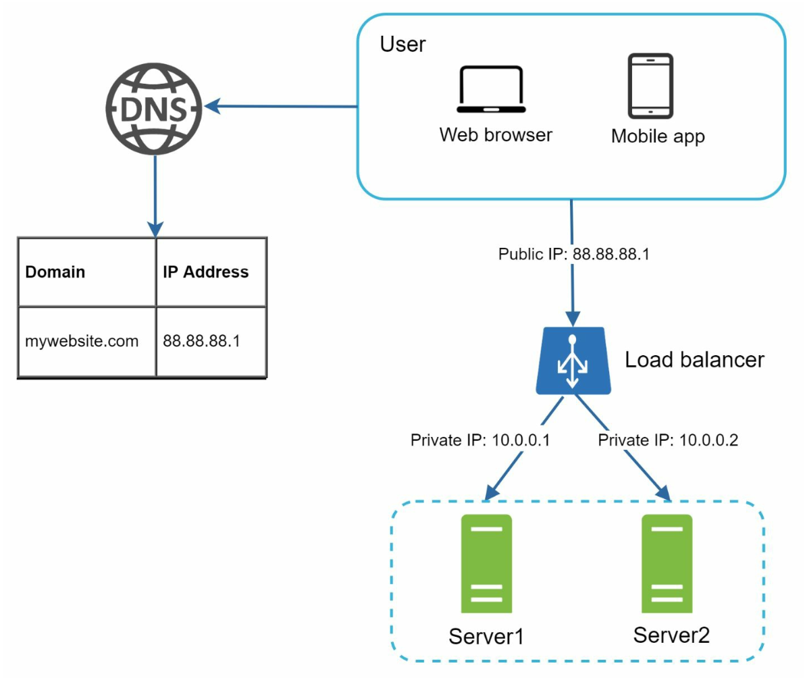

A **load balancer** spreads traffic across multiple servers. What it gives you:
1. Redundancy: if a server goes offline, traffic is rerouted.
   -  If server 1 goes offline, all traffic goes to server 2.
2. Scalability: add servers to handle traffic spikes.
   -  If traffic grows quickly, more servers can be added to take the extra load.

---

## Section 5: Database Replication

   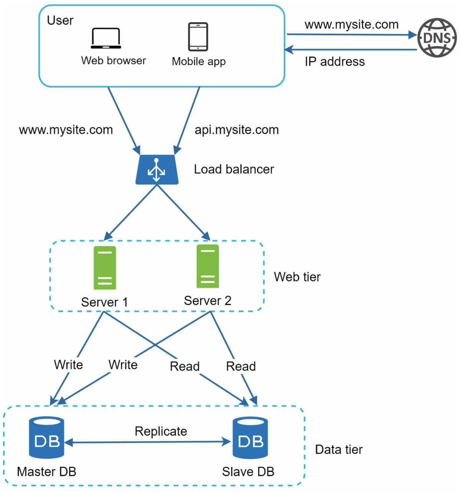

### Master-Slave Model
- **Master Database:** Handles writes.
   - All data-modifying commands (insert, delete, update) go to the master.
- **Slave Databases:** Handle reads, which improves performance and reliability.
   - Most applications read far more than they write, so a system usually has more slave databases than master databases.

### Benefits
1. Better performance, since reads run in parallel.
2. High availability and data reliability through redundancy.

### Failure Handling
- If there is only one slave and it goes offline, reads go to the master temporarily.
- If there are several slaves, reads are redirected to the healthy ones and a new server replaces the old one. 
-  If the master goes offline, a slave is promoted to master.
- In production the promoted slave might not be up to date, so the missing data has to be filled in by running data recovery scripts (multi-master and circular replication could help).

---

## Section 6: Caching
A **cache** keeps frequently accessed data in memory to cut database load. The cache tier is a temporary data store, much faster than the database. 

   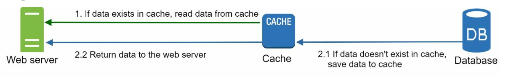

### Caching considerations
1. **Use case**: Use a cache when data is read often but changed rarely.
2. **Expiration Policies:** Expired data is removed from the cache. With no expiration policy, cached data stays in memory permanently.
3. **Consistency:** Keeping the data store and the cache in sync. They can drift apart because updates to the two are not in a single transaction. 
4. **Mitigating failures**: A single cache server is a single point of failure (SPOF). Use multiple cache servers across different data centers to avoid it.
5. **Eviction Policies:** When the cache is full, items have to be evicted to free memory. LRU is the most popular policy.

---

## Section 7: Content Delivery Network (CDN)
A **CDN** speeds up load times by caching static content (images, CSS, JavaScript) on geographically distributed servers.

   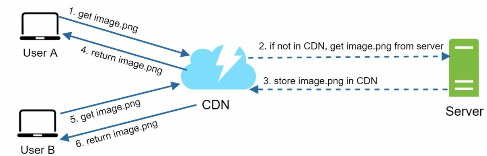

### Workflow
1. The user requests content from the nearest CDN server.
2. If the content isn't there, the CDN fetches it from the origin server and caches it.

### CDN considerations
1. **Cost:** CDNs are run by third-party providers, who charge for data transfer in and out.
2. **Cache Expiry:** The expiry time should be neither too long nor too short.
3. **CDN fallback:** If the CDN has a temporary outage, clients should detect it and request resources from the origin.
4. **Invalidating files:** When files are updated, the cached copies need to be invalidated so they point to the new versions.

---

## Section 8: Stateless Web Tier
Moving session data into a shared datastore makes the web servers stateless. That gives:
1. Easier horizontal scaling.
2. Auto-scaling based on traffic.

   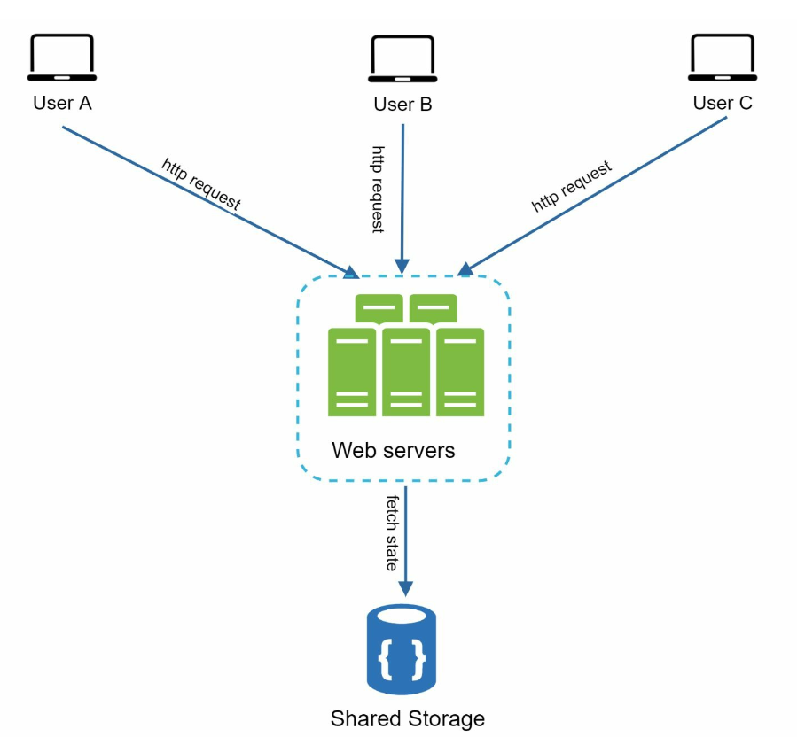

---

## Section 9: Multi-Data Center Setup
Running in multiple data centers improves availability and reduces latency. Strategies:

   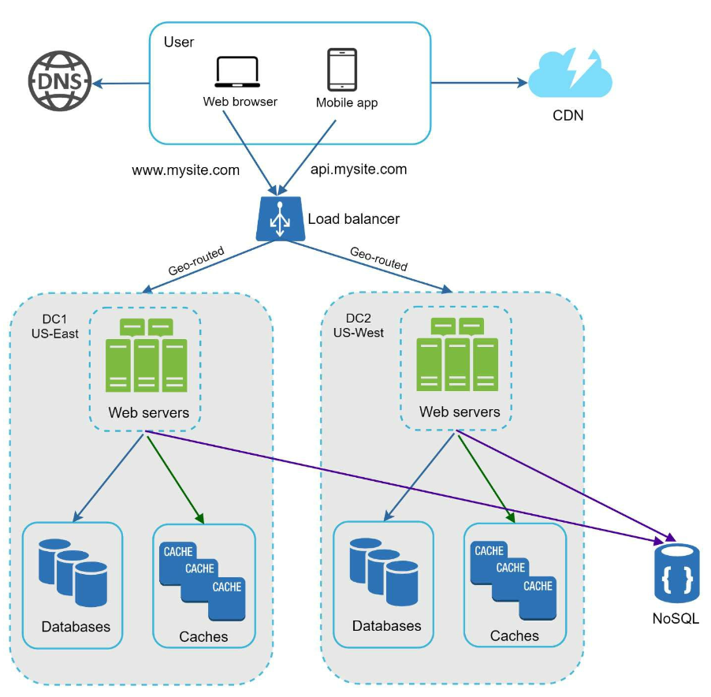

1. **GeoDNS Routing:** Send users to the nearest data center.
2. **Data Replication:** Synchronize data across centers to prevent inconsistencies.

### Considerations
- **Traffic redirection:** You need tooling to send traffic to the right data center.
- **Data synchronization:** A common strategy is to replicate data across data centers. 
- **Test and deployment:**  Automated deployment tools keep services consistent across all data centers.

---

## Section 10: Message Queue
A **message queue** is a durable component, kept in memory, that supports asynchronous communication. It works as a buffer and distributes asynchronous requests.

   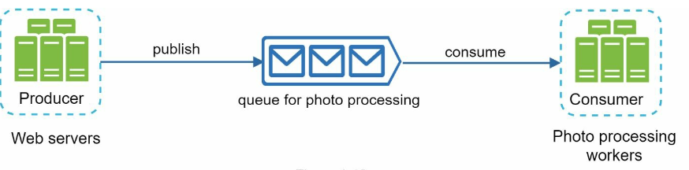

- Input services, called producers/publishers, create messages and publish them to the queue.
- Other services, called consumers/subscribers, connect to the queue and perform the actions the messages define.

---

## Section 11: Logging, Metrics, and Automation

   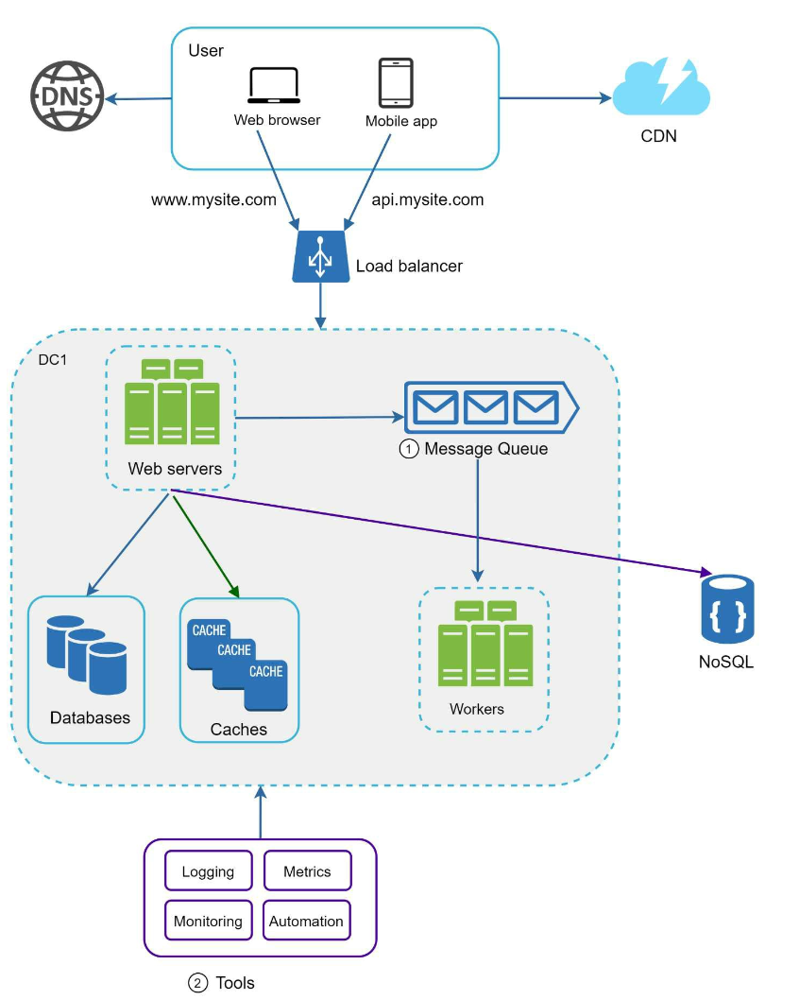

### Why bother
1. **Logging:** Tracks errors and system health.
2. **Metrics:** Shows performance and user activity.
3. **Automation:** Speeds up testing, deployment, and scaling.

---

## Section 12: Database Scaling
### Vertical Scaling
- Add hardware, but there are physical and cost limits.
- Drawbacks:
   -  Higher risk of a single point of failure.
   -  Overall cost is high.

### Horizontal Scaling (Sharding)

   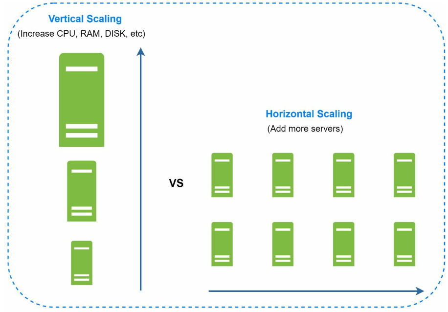

- Split data across multiple shards using a key (e.g., `user_id`).
   - Sharding breaks a large database into smaller, easier-to-manage parts called shards.
   - Every shard has the same schema, but the data on each is unique to it.
-  The sharding key matters a lot. Pick one that distributes data evenly.

#### Challenges 
1. **Resharding data:** Needed when:
   - A single shard can no longer hold more data because of rapid growth. 
   - Some shards fill up faster than others because the data is distributed unevenly (shard exhaustion).
   - Consistent hashing is used to deal with these problems.

2. **Celebrity problem:**  Heavy access to one shard can overload its server.
   - One fix is to give each celebrity a shard of their own.

3. **Join and de-normalization:** Once the database is sharded across servers, joins across shards are hard.
   -  A common workaround is to de-normalize the database so queries hit a single table.

---

## Takeaways
1. Keep the web tier stateless.
2. Build redundancy at every tier.
3. Use caching and CDNs for performance.
4. Scale the data tier with sharding.
5. Decouple components.
