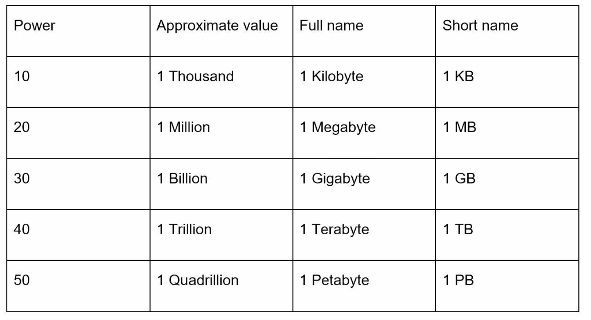

# Chapter 2: Back-of-the-Envelope Estimation

## Introduction
Back-of-the-envelope estimation means quick, rough calculations to judge a system's capacity or performance. Jeff Dean, Google Senior Fellow, describes these estimates as a way to check whether a design meets requirements, using thought experiments and common performance numbers.

This chapter covers the concepts, method, and an example.

---

## Section 1: Concepts

### Power of Two
Data volume is described in powers of two, so you need these memorized:

You need them for storage and bandwidth calculations.

---

### Latency Numbers Every Programmer Should Know
Latency numbers are the time various operations take. They show relative performance:

| Operation                | Latency (2020) |
|--------------------------|----------------|
| L1 Cache Access          | 0.5 ns         |
| L2 Cache Access          | 7 ns           |
| Main Memory Access       | 100 ns         |
| SSD Random Read          | 150 µs         |
| HDD Random Seek          | 10 ms          |
| Round-Trip in Data Center| 500 µs         |
| Inter-Region Data Center | 150 ms         |

**Takeaways from the table:**
- Memory is fast, disk is slow.
- Avoid disk seeks when possible.
- Compress data before sending it over the internet to save bandwidth.

---

### Availability Numbers
High availability (HA) means minimal downtime. Availability is expressed in **nines**:
- **99% (Two Nines):** ~3.65 days/year of downtime
- **99.9% (Three Nines):** ~8.8 hours/year of downtime
- **99.99% (Four Nines):** ~52 minutes/year of downtime
- **99.999% (Five Nines):** ~5.3 minutes/year of downtime
- **99.9999% (Six Nines):** ~31.56 seconds/year of downtime

Cloud providers like Amazon, Google, and Microsoft set their SLAs (Service Level Agreements) at **99.9% or higher**.

---

## Section 2: Example Estimation - Twitter QPS and Storage Requirements

### Assumptions
- **300 million monthly active users (MAU).**
- **50% daily active users (DAU).**
- **Average tweets/user/day:** 2.
- **10% of tweets contain media.**
- **Data retention:** 5 years.

### Estimations
1. **Query Per Second (QPS):**
   - DAU = \( 300M x 50\% = 150M \)
   - Tweets QPS = \( 150M x 2 tweets / 24 hour / 3600 seconds = ~3500 )
   - Peak QPS = \( 2 x 3500 = ~7000 \)

2. **Media Storage:**
   - **Tweet Size Components:**
     - `tweet_id`: 64 bytes
     - `text`: 140 bytes
     - `media`: 1 MB
   - **Daily Media Storage:** \( 150M x 2 x 10\% x 1MB = 30TB per day \)
   - **5-Year Storage:** \( 30TB x 365 x 5 = ~55PB \)

---

## Section 3: Tips

### 1. Rounding and Approximation
Precision doesn't matter here. The process does. Use round numbers to simplify. For example:
- \( 99987 / 9.1 \) can be approximated as \( 100,000 / 10 = 10,000 \).

### 2. Write Down Assumptions
Write them down so you can refer back to them.

### 3. Label Units
Label units to avoid ambiguity (e.g., `5 MB` instead of `5`).

### 4. Common Estimation Scenarios
- **QPS (Queries Per Second):** How much traffic there is.
- **Peak QPS:** Traffic spikes.
- **Storage Requirements:** Total data needed.
- **Cache Requirements:** Memory needed for caching.
- **Number of Servers:** Hardware needed for the workload.
