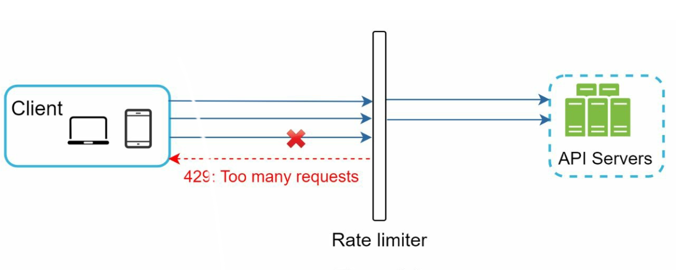
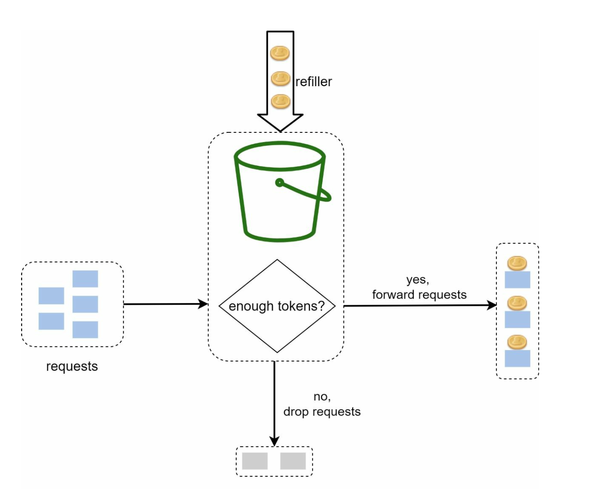
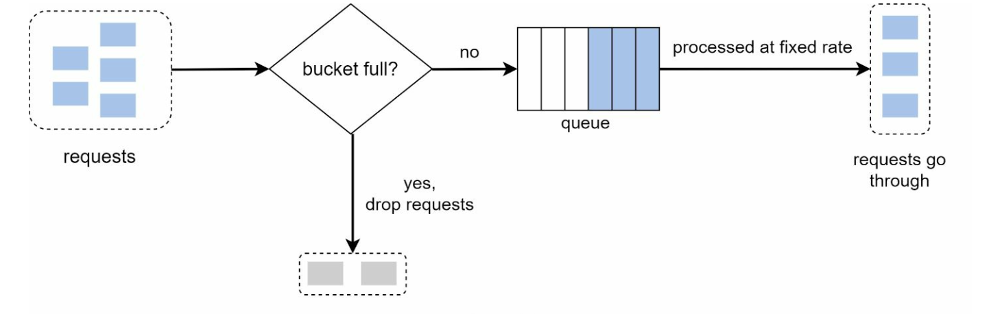
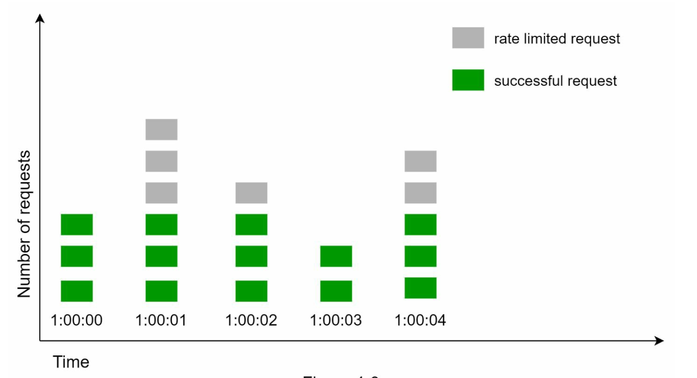
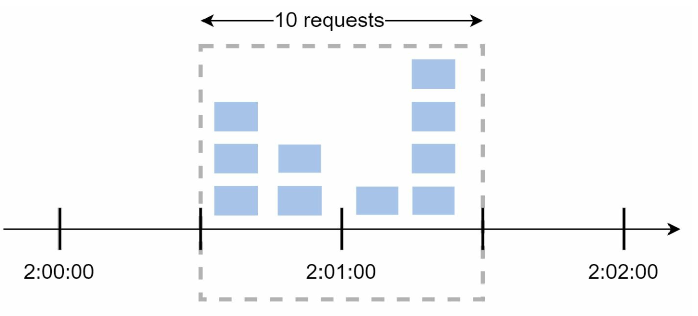
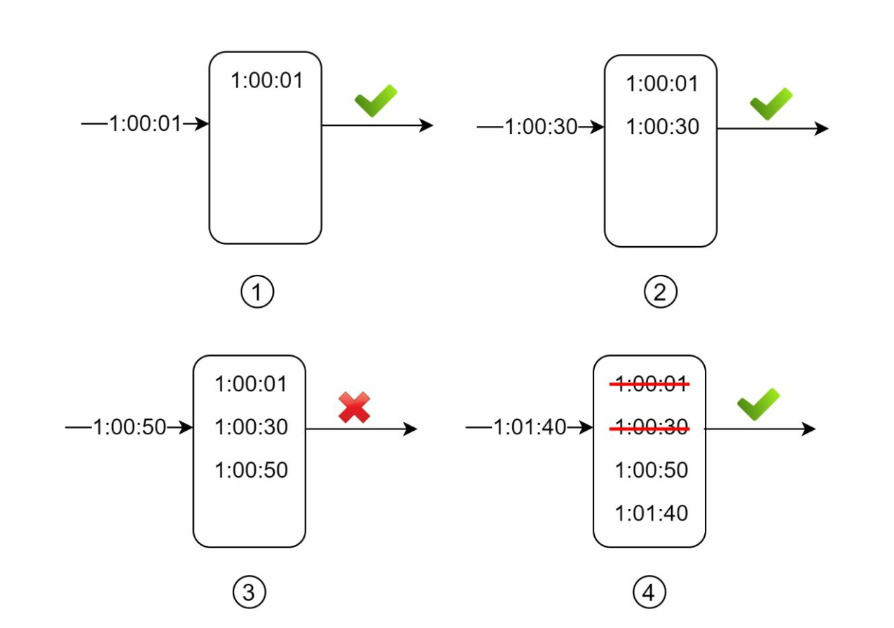
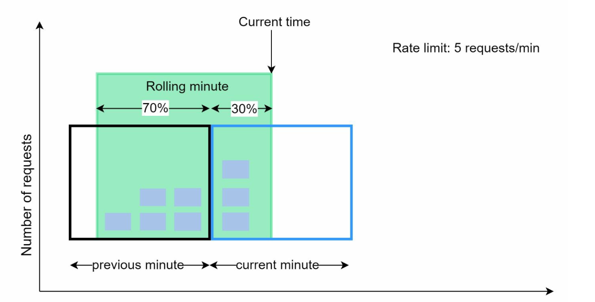
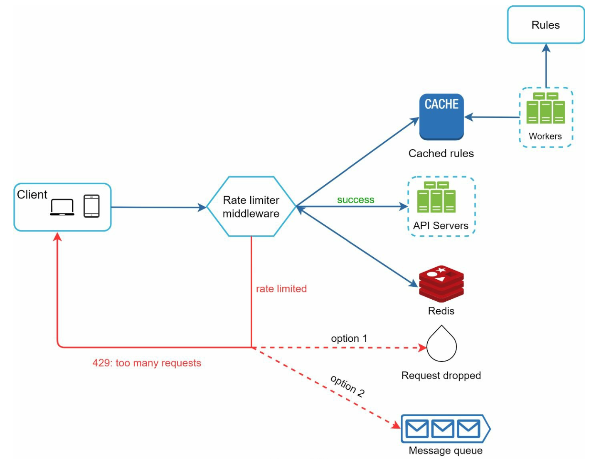

# Chapter 4: Design a Rate Limiter

## Introduction
A rate limiter controls the rate of traffic sent by a client or service. It prevents abuse, cuts costs, and protects server resources. Typical uses: limiting posts, account creations, and reward claims.

## Benefits of Rate Limiting
- **Preventing DoS Attacks:** Block excess calls so resources aren't starved.
- **Cost Reduction:** Fewer unnecessary requests means lower server costs.
- **Preventing Overloads:** Filter out excess requests to keep servers stable.

## Step 1: Understanding the Problem
### Features
- Server-side API rate limiter.
- Multiple throttle rules.
- Works at large scale in distributed environments.
- Either a standalone service or application-level code.
- Tell users when they are throttled.

### Requirements
- Accurate request throttling.
- Low latency.
- Low memory usage.
- Distributed.
- Clear exception handling.
- High fault tolerance.

## Step 2: High-Level Design
### Placement Options

    

1. **Client-Side Implementation:** Unreliable, since clients can be abused or forged.
2. **Server-Side Implementation:** Preferred. More control and more reliable.
3. **Middleware (API Gateway):** Flexible, and integrates rate limiting into the request path.

### Guidelines for Placement
- Look at the current tech stack and pick efficient options.
- Pick algorithms that fit the business need.
- Use an API gateway if you run microservices.
- Go with a commercial solution if resources are limited.

## Step 3: Rate Limiting Algorithms
### 1. Token Bucket

  

- **Description:** Tokens are added to a bucket at a fixed rate. Each request uses up a token.
- **Parameters:** Bucket size and refill rate.
- **Pros:** Easy to implement, memory-efficient, allows bursts of traffic.
- **Cons:** Bucket size and refill rate are hard to tune.

### 2. Leaking Bucket

  

- **Description:** Requests go into a FIFO queue and are processed at a fixed rate.
- **Pros:** Memory-efficient, stable outflow rate.
- **Cons:** A burst of traffic can fill the queue with old requests and delay recent ones.
  

  Example: https://github.com/uber-go/ratelimit

### 3. Fixed Window Counter

  

- **Description:** Time is divided into fixed intervals, and a counter per interval limits requests.
- **Pros:** Simple, efficient for specific use cases.
- **Cons:** Spikes at window edges can let through more than the limit.

- A burst of traffic at the edges of time windows
can let more requests through than the quota allows.

  

### 4. Sliding Window Log

  

- **Description:** Keeps request timestamps, giving a rolling time window.
- **Pros:** Accurate rate limiting.
- **Cons:** Uses a lot of memory.
  

### 5. Sliding Window Counter

  

- **Description:** Combines the fixed window and sliding log approaches to smooth out spikes.
- **Pros:** Memory-efficient, handles bursts.
- **Cons:** It's an approximation, so it may not be perfectly strict.
  

## High-Level Architecture

  

- **Data Storage:** An in-memory cache (e.g., Redis) for fast counter operations.
- **Steps:**
  1. Client sends a request to the middleware.
  2. Middleware checks the counters in Redis.
  3. The request is processed or rejected based on the limits.

## Advanced Considerations
### Distributed Environments
- **Challenges:** Race conditions and synchronization issues.
- **Solutions:** Locks, Lua scripts, or sorted sets in Redis. A centralized data store for synchronization.

### Performance Optimizations
- Multi-data center setups to reduce latency.
- Eventual consistency models for synchronization.

### Monitoring
- Check analytics regularly to see whether the algorithm works and to adjust rules.
